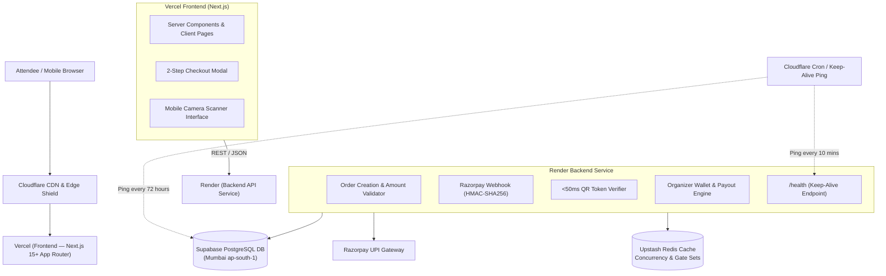

# 02. System Architecture & Technical Specifications

> **Core Topology:** Vercel (Frontend) + Render (Backend API Service) + Supabase (PostgreSQL Database).  
> **Infrastructure Target:** ₹0/Month Free-Tier Stack with 24/7 Keep-Alive Automation.

---

## 1. Complete Architecture Diagram



---

## 2. Layer Separation & Responsibilities

| Layer | Hosting Provider | Technologies | Core Responsibilities |
| :--- | :--- | :--- | :--- |
| **Frontend** | **Vercel** (Hobby Tier) | Next.js 15+, React 19, Tailwind CSS | Ultra-fast Server-Side Rendering (SSR), responsive mobile layouts, 2-step checkout UI, 35mm scalloped cinema ticket rendering, and camera QR scanner interface. |
| **Backend API** | **Render** (Web Service Tier) | Node.js / Express or Next API | Razorpay order generation, HMAC webhook signature verification, organizer wallet ledger calculations, cryptographic QR signing, and <50ms gate scanner verification. |
| **Primary Database** | **Supabase** (Free Tier) | PostgreSQL 17 (Mumbai `ap-south-1`) | 500MB relational storage for `events`, `tickets`, and `withdrawal_requests`. Row-level security (RLS) and relational integrity. |
| **Fast Cache** | **Upstash Redis** | Redis In-Memory | Seat inventory mutex locking (prevents overselling) and gate check-in set cache. |
| **Poster CDN** | **Cloudinary** (Free Tier) | Image CDN & WebP optimization | Auto-compresses event posters to ~50KB WebP for fast Bihar 4G loading. |

---

## 3. The Render Keep-Alive Protocol (Preventing Cold Starts)

### The Challenge
Render free web services spin down to "sleep" mode after 15 minutes of quiet time. When a new request arrives, a sleeping service takes ~50 seconds to wake up. If an attendee pays via UPI and Razorpay sends an instant webhook, a sleeping server might timeout.

### The Solution: Automated 10-Minute Health Ping
1. The Render backend exposes a lightweight, instant health endpoint:
   `GET /api/health -> { status: "ok", timestamp: 1793189000 }`
2. An automated Cloudflare Worker / Cron-Job ping fires every **10 minutes** to this endpoint.
3. Because the ping arrives every 10 minutes (well before the 15-minute inactivity window), the Render container **never sleeps** and remains warm 24/7/365 at ₹0 cost!
4. **Idempotent Webhooks:** In addition, Razorpay automatically retries webhooks up to 5 times if a network blip occurs, and the backend verifies order IDs idempotently.

---

## 4. Frontend & Backend Directory Structure

```
getmyshow/
├── frontend/ (or root Next.js on Vercel)
│   ├── app/                            # Public routes, ticket pass, organizer UI
│   │   ├── (public)/                   # /, /e/[slug], /ticket/[token]
│   │   ├── (organizer)/                # /organizer, /dashboard/[id]
│   │   └── (gate)/                     # /scan/[id] (camera scanner)
│   ├── components/                     # UI components, modals, ticket card
│   ├── lib/                            # API client bridges, formatters, tokens
│   └── public/brand/                   # Brand assets, logos, favicons
├── backend/ (Render Web Service)
│   ├── src/
│   │   ├── routes/
│   │   │   ├── orders.ts               # POST /api/orders/create
│   │   │   ├── webhook.ts              # POST /api/webhook/razorpay (HMAC verified)
│   │   │   ├── verify.ts               # POST /api/scan/verify (<50ms gate check)
│   │   │   ├── wallet.ts               # POST /api/wallet/withdraw
│   │   │   └── health.ts               # GET /api/health (10-min keep-alive ping)
│   │   ├── services/                   # Supabase admin client, Redis, Razorpay
│   │   └── index.ts                    # Server bootstrap
│   └── package.json
└── context/                            # Master Context Files
```

---

## 5. Security & Boundary Rules

* **Secrets Isolation:** All backend secrets (`SUPABASE_SERVICE_ROLE_KEY`, `RAZORPAY_KEY_SECRET`, `QR_HMAC_SECRET`) live exclusively on Render and are never exposed to the Vercel frontend or client browsers.
* **CORS Policy:** Render backend allows incoming requests only from the Vercel frontend domain (`https://getmyshow.vercel.app` or custom domain `https://getmyshow.in`) and `localhost:3000` during local development.
