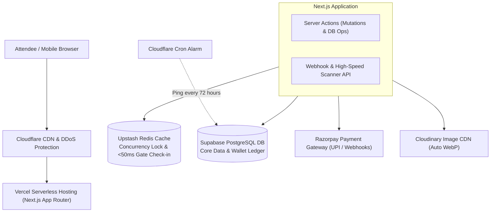
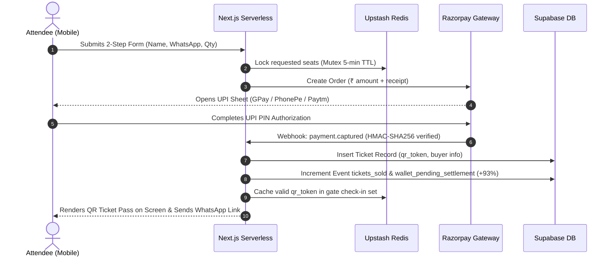

# 02. System Architecture & Technical Specifications

> **Core Philosophy:** ₹0/Month Fixed Overhead, Zero Cold-Start Payment Drop, Lightning-Fast Hyperlocal Performance.

---

## 1. Complete Technology Stack



| Layer | Technology | Free Tier Provider | Purpose & Critical Role |
| :--- | :--- | :--- | :--- |
| **Framework** | Next.js 15+ (App Router), React 19, TypeScript | Vercel (Hobby Tier) | Server-Side Rendering (SSR), Server Components, and zero-cold-start serverless API routes. |
| **Styling** | Tailwind CSS + Lucide Icons | Local Build | Ultra-lightweight utility CSS compiled at build time. Zero runtime CSS overhead. |
| **Primary Database** | PostgreSQL 17 (Relational) | Supabase (Free Tier) | 500MB storage, handles 5,000+ events and 500,000+ ticket rows with strict foreign keys & transactions. |
| **Cache & Concurrency** | Redis (In-Memory Key-Value) | Upstash Redis (Free Tier) | Atomic seat locking (prevents overselling) and <50ms QR code check-in validation at the venue gate. |
| **Image Hosting** | Media Optimization & CDN | Cloudinary (Free Tier) | Auto-converts uploaded event posters into ~50KB WebP images for fast loading on Bihar 4G networks. |
| **DNS & Keep-Alive** | Edge CDN + Cron Worker | Cloudflare (Free Tier) | Global CDN edge caching and scheduled cron pings every 3 days to prevent Supabase 7-day inactivity pausing. |
| **Payments** | UPI Gateway + Webhooks | Razorpay (Primary) / Cashfree (Backup) | 2-click UPI payments (GPay/PhonePe/Paytm); fires instant webhook to confirm ticket and issue QR pass. |

---

## 2. Directory & Folder Structure

```
getmyshow/
├── app/                                # Next.js App Router
│   ├── (public)/                       # Attendee-facing public routes
│   │   ├── page.tsx                    # Hyperlocal homepage & event discovery
│   │   ├── e/[slug]/                   # Event detail & 2-step checkout modal
│   │   └── ticket/[token]/             # Downloadable cryptographic QR ticket pass
│   ├── (organizer)/                    # Organizer administrative routes
│   │   ├── organizer/                  # Organizer portal landing
│   │   ├── organizer/create/           # 60-Second single-page event creator
│   │   └── dashboard/[id]/             # Real-time analytics, wallet & promoter desk
│   ├── (gate)/                         # Venue gate security routes
│   │   └── scan/[id]/                  # 4-Digit PIN camera QR scanner
│   ├── (interactive)/                  # Event stage engagement
│   │   └── poll/[id]/                  # Live audience quiz / Q&A polling screen
│   ├── api/                            # External API & Webhook endpoints
│   │   ├── webhook/razorpay/route.ts   # Cryptographically verified payment webhook
│   │   ├── scan/verify/route.ts        # Ultra-low-latency Redis QR verification endpoint
│   │   └── keep-alive/route.ts         # Supabase ping route for Cloudflare Cron
│   ├── layout.tsx                      # Root layout with font optimization & theme
│   └── globals.css                     # Tailwind base + CSS design tokens
├── components/                         # UI & Feature Components
│   ├── ui/                             # Primitive components (Button, Modal, Input, Badge)
│   ├── checkout/                       # 2-Step checkout modal & UPI payment bridge
│   ├── ticket/                         # Mobile QR pass card, ad banner, and download button
│   ├── dashboard/                      # Sales stats, wallet cards, withdrawal request form
│   ├── promoter/                       # Offline Cash-at-Counter issuance modal
│   └── scanner/                        # Browser camera scanner (html5-qrcode wrapper)
├── lib/                                # Core utilities & external clients
│   ├── supabase/                       # Supabase client (browser, server & admin client)
│   ├── upstash/                        # Redis client for seat locks and ticket caching
│   ├── razorpay/                       # Razorpay order generation & signature verifier
│   ├── qr/                             # HMAC cryptographic QR token generation & validation
│   └── utils.ts                        # Currency formatters (₹ INR), date helpers, classNames
├── actions/                            # Next.js Server Actions (Mutations)
│   ├── events.ts                       # Create event, edit event, toggle fee pass
│   ├── tickets.ts                      # Offline cash pass issuance, resend pass
│   ├── wallet.ts                       # Request withdrawal, fetch ledger history
│   └── poll.ts                         # Submit vote, create stage poll
├── context/                            # Master Project Context Files (The 9 Files)
├── types/                              # Strict TypeScript Definitions & Database Interfaces
├── public/                             # Brand assets, favicons, app icons
└── .env.local                          # Environment variables & secrets (NEVER COMMITTED)
```

---

## 3. Data Flow & Transaction Lifecycles

### A. Online Ticket Purchase (Zero-Login UPI Flow)


### B. Offline Cash Counter / Student Promoter Flow
1. Reception desk or student promoter logs into Promoter Mode.
2. Selects "Issue Cash Ticket", types Buyer Name + WhatsApp Number, and accepts physical cash (₹500 / ₹800).
3. Server Action executes:
   * Sets `payment_mode = 'CASH_PROMOTER'`.
   * Sets `payment_status = 'PAID'`.
   * Increments `tickets_sold` in Supabase.
   * Calculates promoter cash bounty (e.g. ₹20) and organizer cash balance.
   * Generates instant cryptographic QR pass on screen.

### C. Gate QR Verification Flow (<50ms)
1. Security guard opens `/scan/[event-id]` and authenticates with the event's 4-digit PIN.
2. Browser camera scans the QR pass token (`SSM-XXXX-...`).
3. Endpoint checks Upstash Redis cache first:
   * If token not checked in: Redis marks token as checked in (`SETNX`), returns status: `VALID`. Guard screen flashes **Vibrant Emerald Green** with chime sound.
   * If token already checked in: Returns status: `ALREADY_USED` with check-in timestamp. Guard screen flashes **Bright Crimson Red** with alert buzz.
4. Asynchronous write updates Supabase `is_checked_in = TRUE` in the background.

---

## 4. Server Actions vs. API Routes Division

* **Server Actions (`actions/`)**:
  * Used for all client-to-server UI mutations (submitting event creation, issuing cash tickets, requesting wallet payouts, casting poll votes).
  * Enforces automatic type safety, CSRF protection, and co-located error handling without writing repetitive REST boilerplate.
* **API Routes (`app/api/`)**:
  * Reserved strictly for:
    1. **Webhook Receivers**: `/api/webhook/razorpay` (must receive raw body for HMAC cryptographic signature verification).
    2. **Low-Latency Edge Scanner**: `/api/scan/verify` (called asynchronously by camera scanner loop).
    3. **Automated Ping Worker**: `/api/keep-alive` (called by Cloudflare Cron to prevent database pause).

---

## 5. Security & Invariant Boundaries

* **No Cold-Start Webhook Drops**: Backends must never run on sleep-prone containers (like Render free tier). All webhook receivers run on Vercel Serverless with instant wake-up.
* **Zero Client-Side Secret Exposure**: `SUPABASE_SERVICE_ROLE_KEY`, `RAZORPAY_KEY_SECRET`, and `QR_HMAC_SECRET` are strictly server-side environment variables and must NEVER be prefixed with `NEXT_PUBLIC_`.
* **Idempotent Webhook Handling**: Razorpay webhooks can be retried multiple times. The webhook handler verifies `razorpay_order_id` uniquely to prevent issuing duplicate tickets or crediting wallets twice.
