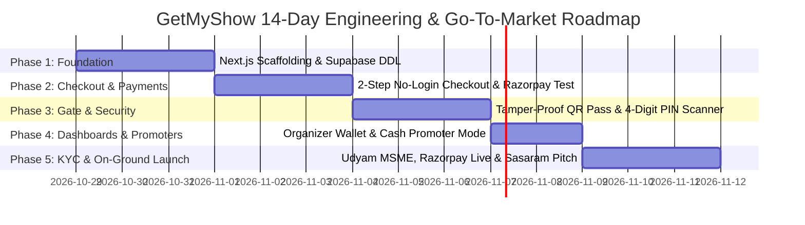

# 03. System Invariants, Legal Rules & 14-Day Launch Roadmap

> **CRITICAL DIRECTIVE:** The rules and boundaries defined in this document represent non-negotiable architectural, financial, and legal constraints. AI agents and developers must never bypass, modify, or violate these rules.

---

## 1. Non-Negotiable System Invariants (What AI Must NEVER Do)

### Invariant 1: The Unified Stack Rule (Never Merge Languages)
* **The Rule:** The entire platform must remain strictly unified on **Next.js (App Router) + TypeScript + Tailwind CSS + Supabase**.
* **Rationale:** Although reference repositories are written in Laravel (`Hi.Events`), Django (`revel-backend`), or Express (`gathio`), we only reverse-engineer their UI workflows, database schemas, and UX concepts. We never stitch PHP or Python runtimes into our production stack.

### Invariant 2: Financial Safety & Wallet Settlement Rules
* **Rule 2.1 — Never Pay Out Unsettled Funds:** Withdrawals are strictly restricted to funds that have already completed Razorpay's **T+2 bank settlement** into our account. Money in `wallet_pending_settlement` can never be paid out early.
* **Rule 2.2 — Event-Completion Holdback (15%):** Organizers can withdraw up to 85% before the event date to pay venue/sound/DJ vendors. The remaining 15% is locked until 8:00 AM the morning after the event concludes to safeguard against last-minute cancellations or scam promotions.
* **Rule 2.3 — Mandatory Bank UTR Logging:** Every organizer payout must have a verified 12-digit Indian Bank UTR (Unique Transaction Reference) number logged before status can transition to `COMPLETED`.

### Invariant 3: Legal, KYC & Anti-Freeze Rules
* **Rule 3.1 — Never Rotate Family Members' PAN Cards:**
  * Rotating different family PANs on the same domain (`yourwebsite.com`) triggers automated aggregator fraud detection inside Razorpay and Cashfree, freezing merchant balances for up to 180 days.
  * In the Indian tax system, the Annual Information Statement (AIS) automatically links all accounts to a single PAN.
* **Rule 3.2 — The 2-Stage Legal Roadmap:**
  * **Stage 1 (₹0 to ₹18 Lakhs GMV):** Sole proprietorship in a trusted parent's name with a free Government of India Udyam MSME Certificate + Razorpay GST Non-Enrollment Declaration + 1-Page Signed Collection Agent Agreement.
  * **Stage 2 (Above ₹18 Lakhs GMV):** Register GST using earned net profits and enable automated gateway split (Razorpay Route or Cashfree Easy Split). With automated splitting, 93% goes direct to the organizer's bank, so only our 7% commission counts towards platform turnover.

### Invariant 4: Free-Tier Cloud Trap Mitigation & Render Keep-Alive
* **Rule 4.1 — Render 10-Minute Keep-Alive Protocol:** The Render backend free web service must have an automated 10-minute health ping configured (via Cloudflare Cron / cron-job.org) targeting `GET /api/health`. This ensures the container never enters the 15-minute sleep state and eliminates cold-start drops for Razorpay payment webhooks.
* **Rule 4.2 — Prevent Supabase 7-Day Inactivity Sleep:** Supabase pauses free PostgreSQL instances after 7 consecutive days of zero traffic (common during school exams in Sasaram). A Cloudflare Cron worker must ping `/api/keep-alive` every 72 hours to ensure 24/7/365 active database availability.

### Invariant 5: Cryptographic QR Security
* All QR codes generated for passes must contain an HMAC-SHA256 signature generated with `QR_HMAC_SECRET`:
  $$\text{QR Token} = \text{EventSlug} + \text{TicketID} + \text{HMAC-SHA256}(\text{TicketID}, \text{Secret})$$
* Gate security scanner validates the cryptographic signature. Static or manipulated screenshots cannot be faked or duplicated.

---

## 2. Complete Database Schema (PostgreSQL 17 on Supabase)

### Table 1: `events`
| Column | Type | Constraints / Default | Description |
| :--- | :--- | :--- | :--- |
| `id` | `UUID` | `PRIMARY KEY DEFAULT gen_random_uuid()` | Unique event identifier |
| `slug` | `TEXT` | `UNIQUE NOT NULL` | URL-friendly slug (e.g. `sasaram-fest-2026`) |
| `title` | `TEXT` | `NOT NULL` | Event display title |
| `description` | `TEXT` | `NULL` | Detailed description & guidelines |
| `venue` | `TEXT` | `NOT NULL` | Physical location (e.g., Post Office Chowk) |
| `city` | `TEXT` | `DEFAULT 'Sasaram'` | Launch city |
| `event_date` | `TIMESTAMPTZ`| `NOT NULL` | Date and time of the event |
| `ticket_price` | `INTEGER` | `NOT NULL` | Base ticket price in INR (e.g. 500) |
| `pass_fee_to_buyer` | `BOOLEAN` | `DEFAULT FALSE` | If TRUE, buyer pays ₹535; organizer gets ₹500 |
| `total_capacity` | `INTEGER` | `NOT NULL` | Total seats/passes available |
| `tickets_sold` | `INTEGER` | `DEFAULT 0` | Counter of sold passes |
| `organizer_name` | `TEXT` | `NOT NULL` | Organizer or institution name |
| `organizer_whatsapp`| `TEXT` | `NOT NULL` | Organizer WhatsApp for alerts |
| `wallet_pending_settlement` | `NUMERIC` | `DEFAULT 0` | 93% share awaiting Razorpay T+2 settlement |
| `wallet_available` | `NUMERIC` | `DEFAULT 0` | Settled funds ready to withdraw |
| `wallet_total_withdrawn` | `NUMERIC` | `DEFAULT 0` | Cumulative total paid out to organizer |
| `scanner_pin` | `TEXT` | `NOT NULL DEFAULT '1234'`| 4-digit PIN for gate scanner volunteers |
| `custom_fields` | `JSONB` | `DEFAULT '[]'` | Custom questionnaire config (Roll No, Class, etc.) |
| `created_at` | `TIMESTAMPTZ`| `DEFAULT now()` | Record creation timestamp |

### Table 2: `tickets`
| Column | Type | Constraints / Default | Description |
| :--- | :--- | :--- | :--- |
| `id` | `UUID` | `PRIMARY KEY DEFAULT gen_random_uuid()` | Unique ticket record ID |
| `event_id` | `UUID` | `REFERENCES events(id) ON DELETE CASCADE`| Event reference |
| `ticket_number` | `TEXT` | `UNIQUE` | Human-friendly ticket number (`GMS-SAS-1001`) |
| `buyer_name` | `TEXT` | `NOT NULL` | Attendee full name |
| `buyer_whatsapp` | `TEXT` | `NOT NULL` | Attendee WhatsApp phone number |
| `payment_mode` | `TEXT` | `DEFAULT 'ONLINE'` | `ONLINE` (UPI) or `CASH_PROMOTER` |
| `quantity` | `INTEGER` | `DEFAULT 1` | Number of passes in this order |
| `amount_paid` | `NUMERIC` | `NOT NULL` | Total amount charged |
| `organizer_share` | `NUMERIC` | `NOT NULL` | Net share credited to organizer wallet |
| `platform_fee` | `NUMERIC` | `NOT NULL` | 7% gross commission |
| `gateway_fee` | `NUMERIC` | `DEFAULT 0` | 2.36% Razorpay fee + GST |
| `net_platform_profit`| `NUMERIC` | `DEFAULT 0` | 4.64% net profit retained |
| `razorpay_order_id`| `TEXT` | `UNIQUE` | Razorpay order reference |
| `payment_status` | `TEXT` | `DEFAULT 'PENDING'` | `PENDING`, `PAID`, `REFUNDED` |
| `qr_token` | `TEXT` | `UNIQUE NOT NULL` | Cryptographic HMAC string inside QR |
| `is_checked_in` | `BOOLEAN` | `DEFAULT FALSE` | Flips to TRUE on gate scan |
| `checked_in_at` | `TIMESTAMPTZ`| `NULL` | Gate check-in timestamp |
| `custom_responses`| `JSONB` | `DEFAULT '{}'` | Answers to custom questions (Class, Batch) |
| `promoter_code` | `TEXT` | `NULL` | Student affiliate tracking code |

### Table 3: `withdrawal_requests`
| Column | Type | Constraints / Default | Description |
| :--- | :--- | :--- | :--- |
| `id` | `UUID` | `PRIMARY KEY DEFAULT gen_random_uuid()` | Unique withdrawal record ID |
| `event_id` | `UUID` | `REFERENCES events(id) ON DELETE CASCADE`| Event reference |
| `amount` | `NUMERIC` | `NOT NULL` | Withdrawal amount requested |
| `payout_destination`| `TEXT` | `NOT NULL` | UPI ID or Bank A/C + IFSC |
| `status` | `TEXT` | `DEFAULT 'REQUESTED'` | `REQUESTED`, `COMPLETED`, `REJECTED` |
| `bank_utr_number`| `TEXT` | `NULL` | 12-digit Indian banking reference number |
| `processed_at` | `TIMESTAMPTZ`| `NULL` | Completion timestamp |

---

## 3. Step-by-Step 14-Day Launch Roadmap

| Sprint Window | Milestone Focus | Deliverables & Verification Checkpoints |
| :--- | :--- | :--- |
| **Days 1–3** | **Base Setup & Foundation** | Scaffolding Next.js 15+ App Router, connecting Supabase PostgreSQL database, applying production SQL schema, setting up Tailwind & design tokens from the brand kit. |
| **Days 4–6** | **Razorpay UPI & 2-Step Checkout** | Build single-scroll event page (`/e/[slug]`), implement 2-step no-login modal (Name + WhatsApp + Qty), integrate Razorpay test mode UPI checkout with instant HMAC-verified webhook. |
| **Days 7–9** | **QR Ticket Pass & Mobile Gate Scanner** | Generate downloadable visual pass with HMAC QR token, sponsor ad banner, and WhatsApp share button. Build password-protected camera QR scanner (`/scan/[id]`) with instant duplicate detection. |
| **Days 10–11**| **Organizer Wallet & Promoter Desk** | Build Organizer Dashboard displaying live tickets sold, Pending vs Available balance, "Request Withdrawal" modal, and offline "Issue Cash Ticket" promoter desk. |
| **Days 12–14**| **KYC & First Local Pitch in Sasaram** | Register free Government Udyam Certificate, activate Razorpay Live KYC under parent sole proprietorship, pitch top 3 coaching institutes or organizers in Gaurakshani / Post Office Chowk area. |

